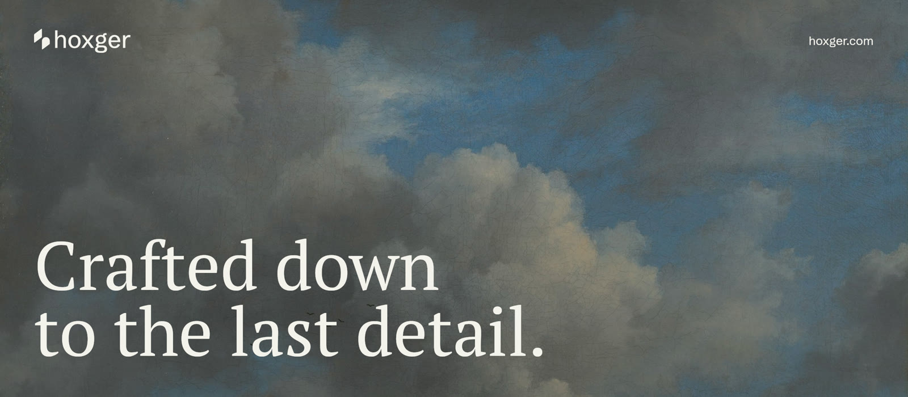
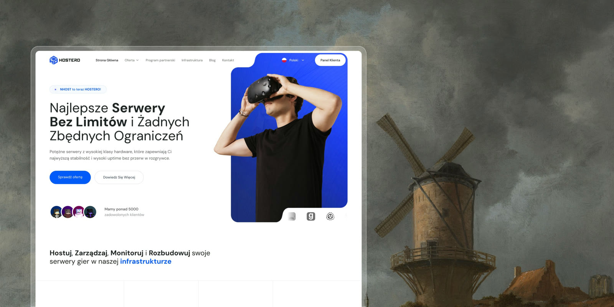

 

Web applications and the infrastructure they run on.

**Stack:** Go, TypeScript, Next.js, React, PostgreSQL, Redis, Kubernetes

## Products

| Project                             | What it is                                 | Stack                                  | Status         |
| ----------------------------------- | ------------------------------------------ | -------------------------------------- | -------------- |
| [Hostero](https://hostero.pl)       | Game server and VPS hosting, 5,000+ customers | Go, Next.js, Kubernetes, PostgreSQL | Production     |
| BetterStatus                        | Uptime monitoring and alerts               | Go, React, PostgreSQL, Redis           | In development |

## Links

[hoxger.com](https://hoxger.com) · [Contact](https://hoxger.com/en#contact)

 

Hoxger sp. z o.o. · KRS 0001227682 · NIP 8971968990
